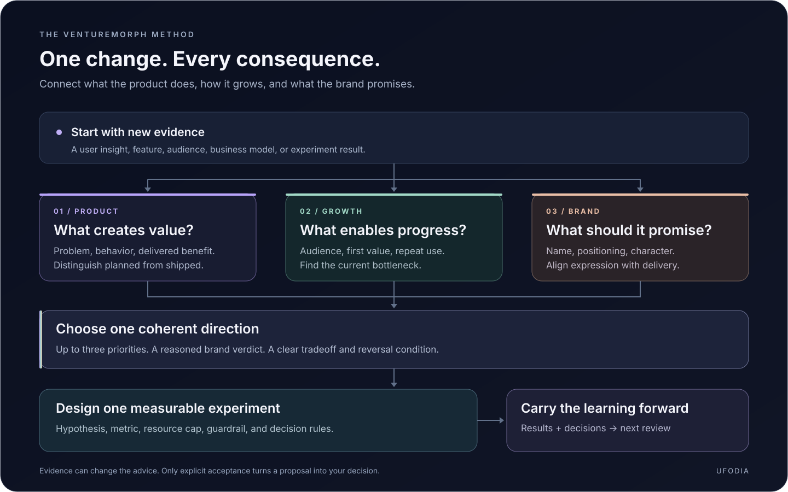

<p align="center">
  <picture>
    
  </picture>
</p>

<h1 align="center">Venturemorph</h1>

<p align="center">
  <strong>Turn changing product evidence into your next decision.</strong><br>
  A portable AI skill for product direction, growth experiments, and brand evolution.
</p>

<p align="center">
  <a href="https://github.com/ufodia/venturemorph/actions/workflows/checks.yml"></a>
  <a href="LICENSE"></a>
  <a href="https://agentskills.io/specification"></a>
  <a href="docs/compatibility.md"></a>
</p>

[What you get](#what-you-get) · [How it works](#how-it-works) · [Install](#install-in-claude-code) · [Example](#a-fictional-before-and-after) · [ChatGPT & other agents](#use-with-chatgpt-and-other-agents) · [Compatibility](docs/compatibility.md)

Venturemorph compares your latest project evidence with the previous state, revisits earlier advice, and returns **up to three priorities, one measurable experiment, and a brand verdict**. It is built for founders, product teams, and independent builders whose product, audience, or growth assumptions are changing.

## What you get

| Review the change | Choose the next move | Carry the context |
| --- | --- | --- |
| See what changed, what still holds, and which earlier recommendations to **keep, revise, or retire**. | Get **up to three prioritized improvements** tied to the product, its growth constraint, and the evidence available. | Keep evidence, decisions, open questions, and prior advice in a **portable project state** for the next review. |

- **One measurable experiment:** a hypothesis, target audience, primary metric, measurement window, and decision rule. Missing baselines stay unknown.
- **A brand verdict:** **keep**, **evolve**, or **rename**, with reasoning about the name, positioning, and personality. Unnamed projects receive positioning and character guidance without an invented existing-name verdict.

> **Evidence stays visible.** Planned is distinct from shipped, hypothesis from fact, and proposed from accepted. A recommendation becomes your decision only when you accept it.

The instructions prohibit invented performance numbers, unsupported or unscoped availability claims, and promises of a perfect or unique strategy. Real domain and handle checks are reported with their source, time, and scope.

## How it works



Bring the current evidence and your latest project state. Venturemorph compares the change, revisits the advice, and proposes priorities and an experiment. Record what you accept, keep unresolved questions open, and bring the updated state to the next review.

The core skill requires **no Python runtime, API key, or hosted service**. Host tools determine whether it can read files, browse sources, or save state. Without those capabilities, provide the evidence manually and save the returned state yourself.

## Install in Claude Code

Copy the skill directory into your personal Claude Code skills directory for local sessions. These examples stop if the destination already exists, so an existing installation is not overwritten. Cloud and Cowork sessions have separate loading rules; see the [official documentation](https://code.claude.com/docs/en/skills).

<details>
<summary><strong>Choose Bash or PowerShell</strong></summary>

### Bash

```bash
(
  set -eu
  git clone https://github.com/ufodia/venturemorph.git
  cd venturemorph
  skill_target="$HOME/.claude/skills/venturemorph"
  if [ -e "$skill_target" ] || [ -L "$skill_target" ]; then
    printf '%s\n' "Already exists: $skill_target. Review it before updating."
    exit 1
  fi
  mkdir -p "$HOME/.claude/skills"
  cp -R skills/venturemorph "$skill_target"
)
```

### PowerShell

```powershell
git clone https://github.com/ufodia/venturemorph.git
if ($LASTEXITCODE -ne 0) { throw 'Clone failed. Resolve it before continuing.' }
Set-Location venturemorph -ErrorAction Stop
$skillParent = Join-Path $HOME '.claude/skills'
$skillTarget = Join-Path $skillParent 'venturemorph'
if (Test-Path -LiteralPath $skillTarget) {
    throw "Already exists: $skillTarget. Review it before updating."
}
New-Item -ItemType Directory -Path $skillParent -Force -ErrorAction Stop | Out-Null
Copy-Item -LiteralPath 'skills/venturemorph' -Destination $skillTarget -Recurse -ErrorAction Stop
```

</details>

Open Claude Code in the project you want to review and invoke the skill:

```text
/venturemorph Review this project. Compare the current product and evidence
with our previous state, revisit prior advice, and give me three priorities,
one measurable experiment, and a keep/evolve/rename brand verdict.
```

Git is used for the installation above. Python is only needed for the optional state checker and repository tests.

## Start with the evidence you have

Share your current product, audience, shipped features, planned work, known bottleneck, brand name and personality, and any observations or measurements. Include the latest project-state file if one exists. If you are starting with an idea, say so; untested assumptions remain hypotheses.

```text
Use Venturemorph to evolve PocketMeal. We started with meal planning for
individuals, but are exploring purchasing workflows for small restaurants.
The shopping-list prototype is shipped; supplier ordering is only planned.
Pilot conversations mention approval delays, but we have no conversion
baseline. Compare this with our previous state and revisit the referral
recommendation. We have not accepted the proposed rename.
```

<details>
<summary><strong>More ways to ask</strong></summary>

These are natural-language request intents, not CLI subcommands:

| Intent | Ask for |
| --- | --- |
| **Review** | Assess the current product, growth constraint, and brand together. |
| **Evolve** | Compare a change with the previous state and reconsider earlier advice. |
| **Grow** | Find the most useful growth bottleneck to investigate next. |
| **Brand** | Evaluate the name, positioning, and personality; decide keep, evolve, or rename. |
| **Experiment** | Turn a priority into one measured test with a decision rule. |
| **Handoff** | Prepare the latest state and unresolved decisions for another session or platform. |

</details>

## A fictional before-and-after

**PocketMeal is an illustrative project, not a customer case study.** These are fictional inputs, not verified results.

| | Earlier state | New evidence and direction |
| --- | --- | --- |
| Product | Meal planning for individuals | A shipped shopping-list prototype; restaurant purchasing is being explored |
| Growth advice | Test a consumer referral loop | Pilot conversations suggest purchasing approvals may be the more useful problem to test |
| Brand | Friendly, personal, everyday convenience | The proposed audience needs clarity, reliability, and team coordination |
| Decisions | Consumer positioning accepted | Restaurant direction and any rename remain proposals |

**The review changes with the evidence:** revisit the consumer referral advice, investigate restaurant approvals, and test the message before committing to a pivot or rename.

<details>
<summary><strong>See the priorities, experiment, and brand verdict</strong></summary>

1. **Validate the purchasing problem:** observe how a restaurant currently requests and approves a purchase before expanding the feature set.
2. **Prototype the approval step:** use the shipped shopping-list flow to test the proposed workflow; do not describe supplier ordering as available.
3. **Rework the message for the proposed audience:** explain the purchasing use case without implying that the team has already committed to the pivot.

**Experiment:** invite relevant pilot participants to complete a purchase-approval task with a prototype. Measure unassisted task completion. Establish the baseline, sample, test window, and success threshold with the team before running the test; do not fill them with invented numbers.

**Brand verdict: evolve, provisionally.** Test a purchasing-workflow descriptor with the proposed audience before changing the name. "PocketMeal" may suggest personal meal planning; that interpretation needs customer evidence. If persistent confusion limits the validated restaurant direction, compare a rename with its transition costs. The pivot and brand update remain proposals, and any replacement name needs separate availability checks.

</details>

## Keep continuity between reviews

Store each project's state in the project being reviewed:

```text
.venturemorph/<project-id>/state.json
```

Start from [`assets/project-state.template.json`](skills/venturemorph/assets/project-state.template.json) when needed; see [the fictional populated example](skills/venturemorph/assets/project-state.example.json) for a complete protocol snapshot. This state belongs to the consumer project, not to the installed skill or this public repository. Keep it private and add `.venturemorph/` to that project's `.gitignore` unless you deliberately choose to version a sanitized record. Remove credentials, personal data, and confidential details before sharing.

For a new session, provide the latest state and the changes since it was written. For another platform, transfer the state manually with the relevant evidence. **Installing the same skill in two places does not synchronize project memory.**

## Use with ChatGPT and other agents

Venturemorph is portable as instructions. Native installation, file access, and persistence depend on the host; see [compatibility and portability](docs/compatibility.md).

For attachment-based use in ChatGPT, provide:

1. [`SKILL.md`](skills/venturemorph/SKILL.md).
2. The four files in [`references/`](skills/venturemorph/references/): evidence/change, growth/experiments, brand/naming, and state format.
3. [The review template](skills/venturemorph/assets/review.template.md) and [the state template](skills/venturemorph/assets/project-state.template.json); [the populated example](skills/venturemorph/assets/project-state.example.json) is optional.
4. Your latest project state and relevant project evidence; include the latest report if the older state omits experiment conditions.
5. [`scripts/check_state.py`](skills/venturemorph/scripts/check_state.py) only if the host can execute Python and you want automated state validation.

Ask ChatGPT to follow the attached workflow. If a reference is missing, the skill returns the available review and labels the missing resource; it does not pretend to have read it. If your workspace supports native installation, install the complete `skills/venturemorph` folder according to that product's instructions.

The repository includes [`agents/openai.yaml`](skills/venturemorph/agents/openai.yaml) for ChatGPT/Codex-facing metadata. Whether a host reads that metadata, installs skills natively, or permits file writes depends on the host. Attachment-based use is a manual workflow; no universal ZIP upload or automatic cross-platform synchronization is assumed. Attachment use alone does not grant file access, browsing, or persistent memory.

## Repository layout

| Path | Purpose |
| --- | --- |
| [`skills/venturemorph/SKILL.md`](skills/venturemorph/SKILL.md) | Entry point and workflow instructions |
| [`skills/venturemorph/references/`](skills/venturemorph/references/) | Supporting review and decision guidance |
| [`skills/venturemorph/assets/`](skills/venturemorph/assets/) | Review scaffold, project-state templates, and example |
| [`skills/venturemorph/agents/`](skills/venturemorph/agents/) | Host-facing metadata |
| [`skills/venturemorph/scripts/`](skills/venturemorph/scripts/) | Optional state validation |
| [`tests/`](tests/) | Repository checks |

<details>
<summary><strong>Validate a state file or run repository checks</strong></summary>

Validate a state file from the repository root with Python:

```bash
python skills/venturemorph/scripts/check_state.py path/to/state.json
```

Run the tests:

```bash
python -m unittest discover -s tests -v
```

The checker uses Python 3.8+ and the standard library. It checks the state structure; it cannot verify whether business evidence is true or a recommendation will work.

</details>

See the [state format](skills/venturemorph/references/state-format.md) for field definitions and the [evaluation guide](docs/evaluation.md) for realistic review scenarios, quality criteria, and the limits of the checks.

## Contribute

See [CONTRIBUTING.md](CONTRIBUTING.md) for scope and validation guidance.

Format and Claude Code installation guidance were checked against the official [Claude Code skills documentation](https://code.claude.com/docs/en/skills) and [Agent Skills specification](https://agentskills.io/specification) on **2026-11-13**. Product support may change; see the compatibility notes before adapting the install to another host.

---

Released under the [MIT license](LICENSE). Copyright © 2026 [ufodia](https://github.com/ufodia).

## Support this project

<p align="center">
  <a href="https://buymeacoffee.com/ufodia">
    
  </a>
</p>
